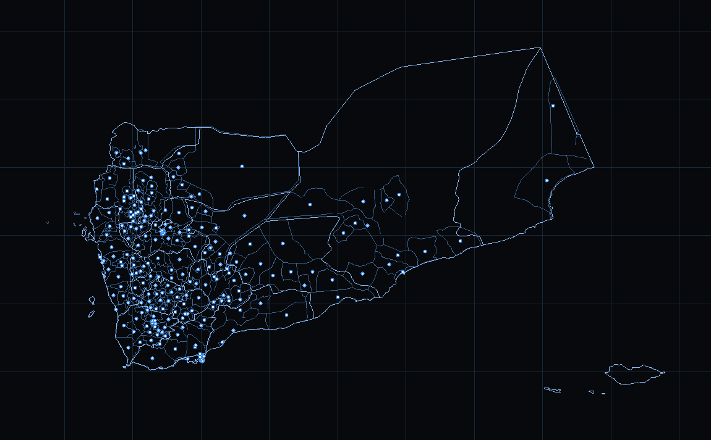

# deplacement — flow map

**Any origin→destination table, on a map, in one HTML file.**

Drop in a CSV of movements — displaced households, trips, trade, migration — and
you get the same page the ArcGIS Pro toolbox writes: a dashboard with the map in
the middle, filters, period and legend on the left, four analysis panels on the
right, and exports for whatever comes next (animated GIF, video, printable PDF,
GeoJSON, GeoParquet, shapefiles, CSV, and a page you can hand over or embed).

The built-in example is Yemeni displacement: 227 districts, 2 832 routes, IOM DTM
Rapid Displacement Tracking, 4 January – 11 October 2026.



`index.html` is the whole app. No build step to run it, no API key, no server, no
upload: open it and it works, offline included.

## Loading your own table

Press **Load data…** (or drop a file anywhere on the page). Nothing is uploaded —
the file is read in the browser and stays there.

The table is one row per flow:

| origin_name | origin_lon | origin_lat | destination_name | destination_lon | destination_lat | date       | value |
| ----------- | ---------- | ---------- | ---------------- | --------------- | --------------- | ---------- | ----- |
| Bamako      | -7.99      | 12.65      | Ségou            | -6.26           | 13.43           | 2026-01-04 | 120   |
| Ségou       | -6.26      | 13.43      | Mopti            | -4.19           | 14.49           | 2026-01-11 | 85    |

A flow can carry **two numbers** — what left and what arrived (the toolbox calls
them the departure and arrival values). Pick the second column in **Arrival
value (optional)**: the line weight follows the departure value, while arrivals,
destinations, arrival groups and the net balance follow the arrival one. Leave
it empty and every figure uses the single value, as before.

- **CSV, TSV, semicolon- or pipe-separated, a JSON array of rows, or a GeoJSON
  FeatureCollection.** The delimiter and the encoding are detected.
- **Columns are detected from the header row** of a CSV you load in the page —
  origin/destination, coordinates, a date or a day number, and a value — and you
  can correct every choice in the dialog before building the map. Headers in English, French or Spanish are
  recognised (`origine`, `ménages`, `destino`, `fecha`, …).
- **Coordinate pairs are read by name, never by position.** `lon_from` with
  `lat_from`, `lon_origine`/`lat_origine`, `o_lon`/`o_lat`, `x_from`/`y_from`,
  latitude before longitude — all of them work, and the two ends are never
  mixed. The dialog sums up where the points will land (`Origin lon 42.9…49.1`)
  and warns when every row starts and ends at the same point, which would draw
  loops instead of lines.
- **Shapefiles load too.** Choose a `.zip` holding the `.shp` (with its `.dbf`,
  and `.shx`/`.prj` when present), or select the `.shp` and `.dbf` together — in
  the table slot, the boundaries slot or the values-by-area slot. Polygons become
  map outlines (or areas with a value), points become places with their `.dbf`
  columns as attributes, and the shapes are read in the browser: nothing is
  uploaded and nothing is unzipped anywhere else. A layer still in a projected
  coordinate system (metres instead of degrees) is reported, not drawn in the
  wrong place.
- **No coordinates? Add a boundary file** (a GeoJSON FeatureCollection of areas,
  up to two levels, or a polygon shapefile). Places are then matched to areas by name — accents, casing
  and spelling wobbles tolerated — and the areas become the limits layer.
- **Or let the limits come by themselves.** Load only the flow table and the
  page reads the country from the coordinates — 242 countries are embedded, so
  it works offline — then fetches that country's regions and districts from
  [geoBoundaries](https://www.geoboundaries.org/), clipped to the extent of
  your points. Yemeni coordinates give Yemen's ADM1 and ADM2, so the group
  names, the limits button and the summary work with nothing else to load. When
  the download cannot happen (no network, firewall, a country the service does
  not cover) the page draws the embedded national outline instead and says why
  in the dialog. Type `YEM` — or `YEM, JOR` — in **Countries** to override the
  detection, or untick **Automatic limits** to load no boundaries at all.
- **A row can be its own origin and destination** (a self-loop): that counts as
  movement inside the place, which is how the example treats internal
  displacement.
- Rows that cannot be placed are **reported, not silently dropped**.
- **Text on the page**: title, subtitle, unit, what one dot and a group are
  called, the two quantity names (_Households targeted_ / _Products
  distributed_) and the source note. They reach the legend, the tooltips, the
  panels and the PDF.
- **Values by area** (optional): a polygon layer carrying a number, or a plain
  table of area names and values. **The value column is chosen, not guessed
  silently**: once the layer is loaded the dialog lists every numeric column in
  a **Value column** drop-down, shows a sample range beside it (`1 240 – 48
900, 214 areas`), and offers a **Legend title** so the key says what is
  mapped — it follows the column until you rename it. Areas are matched to the
  boundary names (or keep their own outlines) and drawn under the flows, with
  their own summary card: total, areas with a value, the maximum, the top areas
  and their share, and the split by group.
- Press **Template CSV** for a file you can fill in.

Everything downstream follows the file: the title, the unit in the stats line,
the labels in the legend, the table headings and the time axis. With two
boundary layers the larger one also names each place's group, so the group
filter, the arrival groups and the summary work without a group column.

## The view

A dashboard, not a canvas with a toolbar bolted on:

- **Header** — title, subtitle, the running indicators, **Flows**, **Notes**,
  **FR/EN**, the light/dark switch, **Export ▾** and **Load data…**.
- **Left** — group and place filters, the period (Play, ‹ ›, cumulative switch,
  the bars, from/up to sliders, All/First/Last), how many routes to show, and the
  legend.
- **Middle** — the map, with one layout slider: **Geo** (true coordinates over a
  background map, with the limits), **Network** (a force layout where places that
  exchange a lot sit together, the basemap fades out and a note says so), and
  everything in between. Zoom with the wheel, drag to pan, **Fit data** to come
  back to the extent of the places.
- **Right** — routes, destinations, arrival groups and net balance, all following
  the period and the filters.
- **Under the map** — the analysis strip and the table of the busiest places.

Hover any dot for its arrivals, departures, internal moves and net figure; its
routes stay lit while the rest fade.

## Exports

| Export                         | What you get                                                                                                                                                                   |
| ------------------------------ | ------------------------------------------------------------------------------------------------------------------------------------------------------------------------------ |
| **Map (PDF, A4)**              | A printable map — title, period, north arrow, scale, legend and source — portrait or landscape chosen from the shape of the data.                                              |
| **Animation (GIF)**            | The whole period as an animated GIF, encoded in the browser.                                                                                                                   |
| **Animation (video)**          | The timeline recorded as a WebM video (MediaRecorder).                                                                                                                         |
| **Data (JSON)**                | The current day: places, flows and totals.                                                                                                                                     |
| **Data (CSV)**                 | Two tables — places and flows — for the current day.                                                                                                                           |
| **Map (GeoJSON)**              | Points, flow lines and area outlines.                                                                                                                                          |
| **Map (GeoParquet)**           | One table with WKB geometry and GeoParquet 1.1 metadata.                                                                                                                       |
| **Map (Shapefile)**            | A ZIP of `places.shp`, `flows.shp`, `areas.shp` with `.shx`, `.dbf` and `.prj`.                                                                                                |
| **Page (self-contained)**      | This whole app with your data baked in — one HTML file, works offline, ready to hand over or publish.                                                                          |
| **Embed (Experience Builder)** | The link, the `<iframe>` code, or the whole page as one file, for the _Embed_ widget of ArcGIS Experience Builder (`embed=1`, `panels=0`, `header=0`, `lang=fr`, `mode=dark`). |

The GIS formats are written from scratch in `src/js/`: a Parquet writer with the
Thrift compact protocol and hand-rolled WKB, a shapefile/ZIP writer, and a GIF
encoder with median-cut quantisation and LZW. Nothing is fetched or bundled.
**Page (self-contained)** re-emits the app's own markup with the current dataset
ahead of the script, so the result is a normal page that boots with your data —
the round trip is covered by a test that exports a page and opens it cold.

Two notes: cross-origin map tiles make the canvas unreadable, so the GIF falls
back to a basemap-free export (the page tells you when it does), and dBase field
names are ASCII, so accented names are transliterated _in the shapefile only_ —
GeoJSON and GeoParquet keep the original spelling.

## What 7.7 brings

The page is the one the toolbox 7.7 writes, and it works on its own:

- **Departure and arrival quantities.** A flow can carry two numbers: the line
  weight follows the departure value, while arrivals, destinations, arrival
  groups and the net balance follow the arrival value. Name both in the page —
  _Households targeted_ / _Products distributed_ — and the legend, the tooltips
  and the PDF all use those words.
- **Arrival groups.** Arrivals counted by the group of the _destination_, not of
  where people came from.
- **Values by area.** A polygon layer — or a table of area names and values —
  drawn under the flows, with its own summary card and map key.
- **Colour of the flows and the moving dots.** Six palettes plus a colour
  picker, remembered between visits and settable in the address (`?flows=teal`).
- **English / Français** on the page, buttons and PDF included.
- **Notes and sources** in a dialog, with a sentence summarising the data.
- **Cumulative or per-period** reading: unticked, the map and every chart show
  only the period on screen.
- **A light and a dark look**, each with its own keyless tile chain.

## Basemaps: keyless by design

CARTO basemaps answer `403 Required API key`, and the standard OpenStreetMap tile
servers refuse requests that do not come from their own site — which is where the
original `403` came from. Both are gone:

| Style     | First choice                   | Then                              |
| --------- | ------------------------------ | --------------------------------- |
| Dark      | Esri _World Dark Gray Canvas_  | Wikimedia Maps → OSM France → OSM |
| Light     | Esri _World Light Gray Canvas_ | Wikimedia Maps → OSM France → OSM |
| Terrain   | OpenTopoMap                    | Wikimedia Maps → OSM France → OSM |
| Satellite | Esri _World Imagery_ (dimmed)  | CyclOSM → OSM France → OSM        |
| None      | — (your data and limits only)  | —                                 |

- **Nothing needs a key, a token or a sign-up.**
- If a server refuses the tiles, the map **moves to the next provider by itself**
  and says so under the controls. A single missing tile is not a dead server; it
  takes a sustained run of failures, and picking a style again retries from the top.
- Light providers used under the Dark style are filtered through CSS
  `invert/hue-rotate`, so a fallback still matches the dark theme.
- Commercial providers were avoided deliberately, and the OSM project servers
  stay last in every chain because their
  [tile usage policy](https://operations.osmfoundation.org/policies/tiles/) is
  the strictest. For a permanent deployment, point the `PROV` table in
  `src/js/tiles.js` at your own tile server.

## Administrative limits

Both layers are embedded in the page, so they never depend on a tile API:

- **Governorates** — Natural Earth 1:10m admin-1 (public domain).
- **Districts** — DIVA-GIS district layer, recovered from a TopoJSON file whose
  declared transform does not match its own coordinates (see `data/README.md`).

Boundary files you load yourself are simplified on the fly, and the label point
of each area is placed inside its own outline. Projection is real Web Mercator,
shared by tiles, points and limits. The zoom is the deepest one whose 256 px tiles
still land on ~110 CSS px, and the frame covers everything loaded.

## In ArcGIS Pro

The same page can be produced from inside a project. `arcgis/FlowMap.pyt` is a
Python toolbox: point it at a flow table, optionally a places layer and outline
polygons, press Run, and it writes the same self-contained HTML file — the map,
the timeline, the exports, all of it.

```
Insert > Toolbox > Add Toolbox…   pick FlowMap.pyt
Flow map > Build a flow map page (6.9)   choose your layers
```

Every column parameter below the table is a drop-down of that table's own
columns, filled when the tool opens as well as when the table changes, and no
field is ever filled in for you: the lists are offered, you pick.

The version is in the tool's own title on purpose: it is the one place where a
screenshot of the pane says which build is installed. A toolbox left beside an
older `flowmap_core.py` refuses to run instead of quietly building the old page,
and every page ends its source line with `Built with FlowMap 6.9`.

Everything that decides what the page shows lives in `arcgis/flowmap_core.py`,
which imports nothing but the standard library, so it runs (and is tested)
without ArcGIS:

```sh
python3 arcgis/flowmap_core.py selftest                          # 59 checks
python3 arcgis/flowmap_core.py demo --out demo.html               # a page from an invented table
python3 arcgis/flowmap_core.py build --input spec.json --out page.html
node tools/package-arcgis.mjs                                     # dist/ + a zip for Pro
```

Geometries are read through a cursor asking for WGS84, so a project in metres
still lands in the right place; names are matched to the places layer and the
outlines ignoring accents, case and decorations; dates become days counted from
the earliest one; a value of 0 or a name that cannot be found is dropped and
reported. `arcgis/README.md` has the parameter list, three worked recipes, the
recipe for a .NET dockpane add-in, and what the tests do and do not cover.

## Layout

```
index.html               the built app — the only file a visitor needs
src/template.html        page shell: markup, controls, loader dialog, notes
src/styles.css           the dashboard, light and dark
src/js/                  the app, in load order (no imports; build.mjs concatenates)
  core.js                DOM handles, theme colours, formatters
  geo.js                 ring areas, centroids, simplification, point-in-polygon
  table.js               CSV/TSV/JSON/GeoJSON reader and column detection
  shpread.js             shapefile and ZIP reader (.shp/.dbf -> GeoJSON)
  countries.js           country of a point (embedded outlines) -> geoBoundaries
  sources.js             table + boundaries -> dataset, geocoding by name
  dataset.js             the active dataset, normalising boundary layers
  projection.js          Web Mercator, tiling, limits projection
  tiles.js               tile providers, fallback chains, status line
  limits.js              area outlines and labels
  aggregate.js           day-by-day totals, routes, stats line
  simulate.js            force layout and the geo/network blend
  render.js              one draw pass
  gif.js                 animated GIF encoder (median cut + LZW)
  shp.js                 shapefile + ZIP writer
  parquet.js             GeoParquet writer (Thrift compact, WKB)
  export.js              snapshots, downloads, frame capture
  pdf.js                 the printable A4 map (canvas -> JPEG -> PDF)
  menu.js                the export menu
  ui.js                  controls, events, timeline, zoom and pan
  loader.js              the data loader dialog and its mapping form
  i18n.js                English / French, message by message
  panels.js              filters, analysis panels, colour, theme layer, notes
  wiring.js              boots the page and reports a failure on it
vendor/d3-force.js       the one library the page uses, inlined by build.mjs
                         (generated by tools/vendor-d3.mjs, self-checked)
data/                    the built-in example (see data/README.md)
arcgis/                  the ArcGIS Pro side: FlowMap.pyt + flowmap_core.py
                         (see arcgis/README.md)
test/                    Node test suite: stubbed DOM, canvas, tiles, blobs
                         — nothing is injected that the page does not carry itself
tools/build-countries.mjs   rebuild data/countries.json from Natural Earth
tools/build-boundaries.mjs  rebuild the example boundaries from source
tools/render-map.mjs        render any built page to a PNG for eyeballing
tools/verify-exports.py     read the exports back with pyarrow/pyshp/Pillow/geopandas
tools/vendor-d3.mjs         rebuild the inlined d3-force bundle
tools/arcgis/               a stand-in for arcpy, and the checks that drive the toolbox
build.mjs                glues vendor/ + src/ + data/ into index.html
```

## Working on it

```sh
npm install             # prettier only
npm run build           # vendor/ + src/ + data/  ->  index.html
npm run check           # fail if index.html is out of date
npm test                # the whole suite: page, loader, exports, boundaries, ArcGIS
npm run render          # write tools/out/map-check.png
npm run vendor          # rebuild the inlined d3-force bundle
npm run boundaries      # rebuild data/boundaries-*.json from source
npm run countries       # rebuild data/countries.json (Natural Earth, 242 countries)
npm run arcgis:selftest # the ArcGIS core + the toolbox, without ArcGIS
npm run package:arcgis  # dist/arcgis-pro/ + dist/FlowMap-arcgis-pro.zip
npm run serve           # static server on :8000
```

`npm run verify:exports` also reads the exported files back with **pyarrow**,
**geopandas**, **pyshp** and **Pillow** (`pip install pyarrow pyshp pillow
geopandas`), which is how the writers are kept honest — it is what caught the
unclosed polygon rings and the DBF field-type bug.

The test suite loads the built page in Node with a stubbed DOM, canvas, image
loader and Blob/URL, then drives it: it loads tables through the real loader code,
clicks the controls, fires tile loads and failures by hand, and inspects the
exported bytes. Nothing is injected that the page does not carry itself — a
stubbed library is how a missing `d3` once reached a live site, so the tests now
load the page exactly as a browser would, then tick the layout themselves.

The ArcGIS toolbox is checked the same way: `test/arcgis.test.mjs` runs the Python
core, drives `FlowMap.pyt` through a stand-in for arcpy, and loads the page the
toolbox wrote in the same browser harness, comparing it number for number with
the dataset the toolbox reported. CI runs formatting, `build --check`, the tests,
the render, the export round trip and the ArcGIS packaging.

## Data

Source: IOM DTM Rapid Displacement Tracking, district level. Households are
counted from assessments and summed from 4 January to the chosen date, so a family
assessed twice counts twice — these are movements recorded, not a snapshot of
people displaced. See `data/README.md` for the payloads, their licences and the
rebuild procedure.

## Licence

MIT for the code (see `LICENSE`). The example data keeps the licence of its
source: Natural Earth is public domain (the embedded country outlines come from
it), geoBoundaries is CC BY 4.0 (the regions and districts the page downloads
carry their own credit on the map), DIVA-GIS boundaries are free for
non-commercial use, and the displacement figures belong to IOM DTM. Basemaps
belong to their providers and carry their own attribution, printed on the map.
